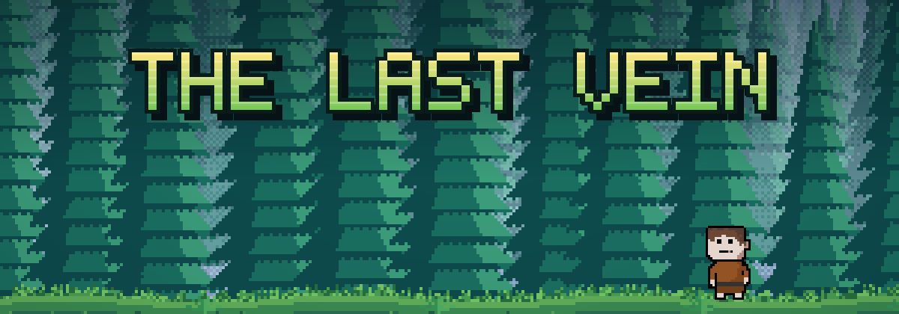

<p align="center">
  
</p>

<p align="center">
  
  
  
  
</p>

# The Last Vein

Пиксельная 2D-игра в стиле Terraria на Python и pygame. Вид сбоку, свой герой, свои анимации, главное меню и экран настроек.

> **Статус: beta.** Это ранняя версия. Основа игры (движение, прыжок, удар, меню) уже есть, а враги, предметы и добыча руды пока впереди. Честный список того, что работает и чего нет, ниже.

<!-- TODO: коротко о сюжете игры (2-3 предложения) -->

---

## Что уже есть

- **Главное меню** с кнопкой Play и значком настроек, размытый фон с затемнением
- **Ходьба** влево и вправо с анимацией, герой разворачивается по направлению движения
- **Прыжок** с гравитацией
- **Удар** со своей анимацией
- **Анимация покоя**, когда герой стоит
- **Экран настроек**, открывается значком в меню или клавишей `Esc` во время игры
- **Земля из блоков** и пиксельный фон

## Что пока не готово

- Яркость в настройках: кнопки `+` и `-` и значение `80%` нарисованы, но ещё ничего не меняют
- Враги и предметы: файлы `enemies.json` и `items.json` созданы, но пока пустые
- Характеристики и инвентарь из `player.json` (здоровье, урон, скорость, вещи) пока не подключены к игре
- Добыча руды, звук, сохранения

---

## Управление

| Клавиша / действие | Что делает |
|---|---|
| `A` / `D` | Ходьба влево / вправо |
| `Пробел` | Прыжок |
| `E` | Удар |
| `Esc` | Открыть / закрыть настройки (во время игры) |
| Клик мышью | Кнопка Play и значок настроек в меню |

---

## Запуск

Нужен **Python 3.12** (на нём игра сейчас проверяется) и **pygame 2.6**.

```bash
git clone https://github.com/ScuizzyBytes/dark-dungeon.git
pip install pygame
python dark-dungeon/main.py
```

> **Важно:** запускай из папки, *в которой лежит* `dark-dungeon`, а не из самой папки `dark-dungeon`. Пути к картинкам и json-файлам сейчас заданы относительно неё, и из другого места игра не найдёт файлы.

Если `pip` ругается на системный Python (Linux), создай виртуальное окружение:

```bash
python3 -m venv .venv
source .venv/bin/activate
pip install pygame
```

---

## Структура проекта

<details>
<summary>Показать</summary>

```
dark-dungeon/
├── main.py                 # точка входа
├── src/
│   ├── engine.py           # класс Game: меню, настройки, игровой цикл
│   └── frames_load.py      # загрузка кадров анимаций
├── data/
│   ├── player.json         # состояние, характеристики и инвентарь героя
│   ├── main_menu.json      # позиции и размеры кнопок меню и настроек
│   ├── enemies.json        # пока пусто
│   └── items.json          # пока пусто
└── assets/
    ├── background.png      # фон
    ├── block.png, block1.png
    ├── player.png
    ├── settings.png        # значок настроек
    ├── walk_anim/          # кадры ходьбы
    ├── idle_anim/          # кадры покоя
    └── attack_frames/      # кадры удара
```

</details>

### Настройка через JSON

- `data/main_menu.json` задаёт положение и размер кнопок меню и экрана настроек, их можно двигать без правки кода.
- `data/player.json` хранит стартовое состояние анимаций героя. Остальные поля (характеристики, инвентарь) подготовлены на будущее.

---

## Планы

- [x] Главное меню и экран настроек
- [x] Ходьба, прыжок, удар, анимация покоя
- [ ] Рабочая яркость и другие настройки
- [ ] Враги
- [ ] Предметы и инвентарь
- [ ] Добыча руды
- [ ] Звук и музыка
- [ ] Сохранения

---

## Автор

Сделал [ScuizzyBytes](https://github.com/ScuizzyBytes). Фон и кадры анимаций созданы с помощью Claude (Anthropic).

Нашёл баг или есть идея? Открой [issue](https://github.com/ScuizzyBytes/dark-dungeon/issues).
